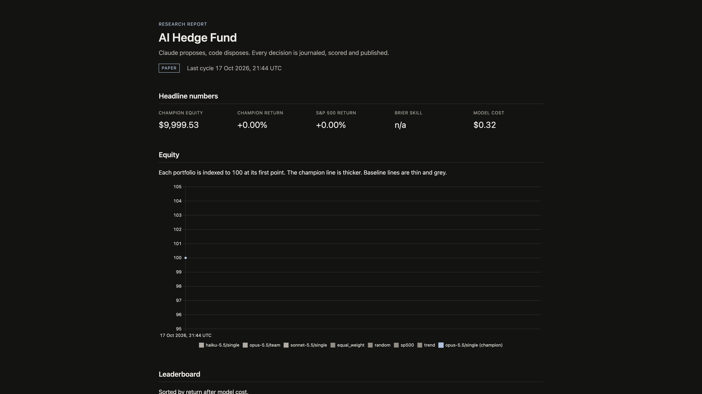
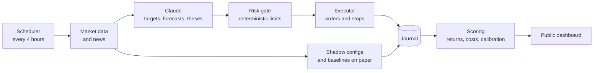

# AI Hedge Fund

An autonomous, multi asset AI fund that runs in public. Claude proposes, code disposes, and every decision is journaled, scored and published.

[](https://github.com/chase-mew/ai-hedge-fund/actions/workflows/ci.yml)
[Dashboard](https://chase-mew.github.io/ai-hedge-fund/)



## What it does

Every four hours the fund:

- Takes a snapshot of eleven liquid markets: US stock indices, large US stocks, gold, oil, the dollar against the yen, then bitcoin and ether.
- Asks Claude for a target weight, a 24 hour probability, a stop and a short thesis for every market.
- Passes that proposal through a deterministic risk gate. The model never sends an order.
- Executes the gated book on the execution venue when a live mode is on, and always keeps paper books for the other model configurations and for four rule based baselines.
- Journals the inputs, the decision, the reasoning summary, the orders and the costs, then publishes them.

## How it is built

1. **A workflow, not an agent loop.** The steps are known in advance, so the code runs them in order and calls Claude only for judgement. A fixed workflow is the simplest thing that works, and it is cheaper to inspect when something looks wrong.
2. **Claude proposes, code disposes.** Claude outputs target weights, probabilities, stops and reasons. Deterministic code owns every limit, every order and every key.
3. **Small blast radius.** A dedicated wallet, an agent key that cannot withdraw, an equity ceiling, exchange side stops and a drawdown halt keep a bad cycle from growing.
4. **Glass box.** Every input, output, reasoning summary, gate decision, order and dollar of cost is journaled and published.
5. **Forward only evaluation.** Large language models have memorised prices up to their training cutoff, so a backtest over that history is contaminated. Hiding tickers or dates does not repair it. Published live trading benchmarks also show models losing money through overtrading and fees, which is why costs stay in the score.
6. **Fail closed.** A failure in data, a decision or execution adds no new risk for that cycle.
7. **Pure core, thin shell.** Features, the gate, sizing, accounting and scoring are pure functions. Network calls live in a few modules, so the core can be tested without keys.

## Architecture



| Module | Role |
| --- | --- |
| `cycle.py` | Runs one cycle in a fixed order. |
| `data/` | Public market data, features and the snapshot. |
| `brain/` | Prompts, Claude calls, the news digest and the offline fake model. |
| `risk/` | The deterministic gate. |
| `execution/` | Turns gated weights into orders and stops. |
| `venues/` | Paper accounting and the execution venue. |
| `journal/` | Cycle records, forecasts, equity and transcripts. |
| `scoring/` | Returns, costs, Brier score and calibration. |
| `dashboard/` | The static research site. |
| `cli.py` | `fund run`, `status`, `score`, `dashboard`, `halt`, `resume`, `doctor`, `replay`. |

## Safety

Real orders, when you turn them on, pass through every layer below.

- The trading wallet is dedicated to this project. Its private key is never stored here.
- The agent key can trade and cannot withdraw.
- Live equity above the ceiling in `fund.toml` is refused.
- The risk gate clips size, gross exposure, net exposure, new risk, closed markets and flips.
- Stops are placed on the exchange after fills.
- A drawdown through the high water mark halts the book and flattens it.
- `fund halt` stops the next cycle. `fund halt --flatten` also closes the live book.
- Autonomy defaults to approve, which prints the plan and waits for a person.
- Mainnet trading stays off unless `FUND_ALLOW_MAINNET` is `yes`.

## Results

The public dashboard is the record: [chase-mew.github.io/ai-hedge-fund](https://chase-mew.github.io/ai-hedge-fund/).

Figures start at the first published cycle. There is no backtest. Fees, funding and model costs are included. Until there are hundreds of cycles, treat any result as an anecdote about this experiment, not as evidence of an edge.

## Quickstart

Install [uv](https://docs.astral.sh/uv/) and Python 3.13, then:

```bash
uv sync
uv run fund run --mode paper --fake-llm
uv run fund status
uv run fund score
uv run fund dashboard --out site
```

That path needs no API keys. The offline model follows a fixed rule based on the 20 day average.

With `ANTHROPIC_API_KEY` in `.env`:

```bash
uv run fund doctor
uv run fund run --mode paper
uv run fund dashboard --out site
open site/index.html
```

Copy `.env.example` to `.env` and fill in only the keys you are using.

## Configuration

`fund.toml` holds the fund name, the cycle length, the paper starting equity and the daily model budget. It names the champion and the shadow configurations, the model prices, and whether the news digest is on. The risk section is the gate: per market weight, gross, net, new risk, drawdown, stops and class caps. The execution section is leverage, minimum order size, slippage, the price gap limit and the live equity ceiling. The universe lists the eleven markets.

## Running with real orders

Start on testnet. Use a new wallet, fund it with a small mainnet deposit so the testnet faucet can be claimed, then create an agent key with `scripts/setup_agent.py`. Put the address and the testnet agent key in `.env`. Do not put the wallet private key in `.env`.

`autonomy` in `fund.toml` applies only to the real venue:

- `paper` never sends a real order.
- `approve` prints the gated plan and waits.
- `auto` sends the gated plan. This is the mode for an unattended run, after you have watched approve mode.

`fund run --mode testnet` uses test funds. `fund run --mode live` is refused unless `FUND_ALLOW_MAINNET=yes`. `fund halt --flatten --mode testnet` closes the book. `fund resume` clears the halt after you confirm.

The testnet faucet pays 1,000 mock USDC only to an address that has already deposited on mainnet. The minimum mainnet deposit is 5 USDC. There is no way around that step.

## Automation

`.github/workflows/cycle.yml` runs one cycle, scores it, builds the dashboard, and publishes both the journal branch and GitHub Pages. Start it by hand with Actions, or with `gh workflow run cycle.yml -f mode=paper`.

The four hour schedule is commented out. A push does not spend the model budget by itself. To turn unattended runs on, uncomment the schedule, add `ANTHROPIC_API_KEY` as an Actions secret, and set the repository variable `FUND_MODE` to `paper`. GitHub disables scheduled workflows on a public repository after 60 days without activity.

## Development

```bash
make check
```

That runs ruff, pyright and pytest with coverage. Live network tests are marked `live` and stay off unless you pass `-m live`.

Offline tests use recorded market responses in `tests/fixtures/` and `FakeClaude`. Golden prompt files live in `tests/golden/`. Update them with `uv run pytest tests/test_render.py --update-golden` only when a prompt change is intentional.

To add a model configuration, add a catalog entry and a `model/style` id under `shadows` in `fund.toml`. `style` is `single` or `team`. The champion is the one id that can trade the real account.

`fund replay tests/fixtures/snapshot_real.json --times 3` reruns the champion on a saved snapshot and sends no orders. It needs `ANTHROPIC_API_KEY`.

## History

The first version, from January 2025, was built in a day. It was a TypeScript chain of GPT 4 agents, styled as employees reporting to a chief executive. Each agent wrapped one financial data endpoint. It was slow, it made sequential recursive calls, and it had no portfolio state, no risk limits, no evaluation and a fake exchange that only printed. This version keeps the idea of a model proposing trades and replaces everything else. The original is preserved at the `v0-legacy` tag.

## Disclaimer

This is an experiment, not investment advice. Trading leveraged derivatives can lose money. There is no warranty.

## License

MIT. See [LICENSE](LICENSE).
